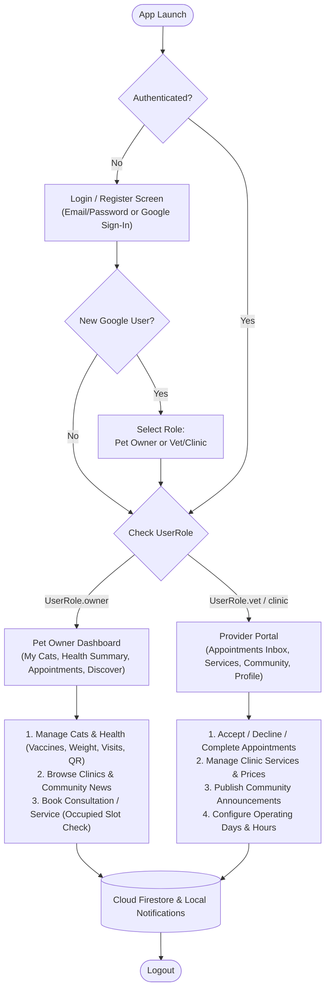

# ADVANCE MOBILE APPLICATION DEVELOPMENT
## FINAL PROJECT DOCUMENTATION

---

### PROJECT TITLE
**PurrSync: A Mobile-Based Health, Vaccination, Nutrition, and Veterinary Clinic Appointment Management System for Multi-Cat Households**

- **Prepared by:** Rote, Ferdinand A.
- **Subject:** Advance Mobile Application Development
- **Submitted to:** Prof. Paul John D. Cabance
- **Date Submitted:** October 19, 2026

---

## TABLE OF CONTENTS

- **CHAPTER 1 – PROJECT OVERVIEW** ................................................................. 3
  - Introduction
  - Project Objectives
  - Scope of the Project
  - Limitations
- **CHAPTER 2 – SYSTEM ANALYSIS AND DESIGN** ............................................. 5
  - System Description
  - System Flow
  - Use Case Diagram
  - Database Design
  - User Interface Design
- **CHAPTER 3 – SYSTEM DEVELOPMENT** ........................................................... 8
  - Tools and Technologies Used
  - Development Process
- **CHAPTER 4 – RESULTS AND TESTING** .......................................................... 10
  - System Features
  - Functional Testing
  - Evaluation
- **CHAPTER 5 – CONCLUSION AND RECOMMENDATIONS** .......................... 13
  - Conclusion
  - Recommendations
- **APPENDICES** ................................................................................................. 15
  - Appendix A – Screenshots of the Application
  - Appendix B – Source Code Snippets
  - Appendix C – User Manual

---

## CHAPTER 1
## PROJECT OVERVIEW

### Introduction
The project entitled **"PurrSync: A Mobile-Based Health, Vaccination, Nutrition, and Veterinary Clinic Appointment Management System for Multi-Cat Households"** is a cross-platform mobile and web application developed using Flutter and Firebase to assist cat owners, foster caretakers, and veterinary clinics in managing feline health records and veterinary appointments. Instead of relying on fragile paper vaccination booklets, scattered notes, or manual messaging to book clinic visits, PurrSync provides an all-in-one digital platform. Pet owners can maintain longitudinal records of each cat's weight trends, vaccination schedules, and veterinary consultation history, while seamlessly discovering nearby veterinary clinics, booking services, and receiving real-time community health announcements.

### Project Objectives

#### General Objective
To design and develop a multi-role mobile application that addresses the needs of multi-cat owners and veterinary service providers in tracking feline health records, automating vaccination reminders, preventing appointment double-bookings, and facilitating clinic-to-owner communication anytime through mobile and web devices.

#### Specific Objectives
1. To create an intuitive, Material 3 "Warm Boutique" user interface tailored for both **Pet Owners** and **Veterinary / Clinic Providers**.
2. To provide complete and reliable data management (Create, Read, Update, Delete) for cat profiles, medical records (weight logs, vaccinations, vet visits), clinic service catalogs, appointments, and community announcements.
3. To integrate **Google Sign-In (OAuth 2.0)** alongside email/password authentication with role-based onboarding and email verification.
4. To enforce biological and scheduling validation rules, including preventing vaccine/weight dates prior to a cat's birth date and preventing occupied time-slot double-bookings.
5. To integrate live REST APIs (Google Cloud Firestore REST API and the public Cat Facts REST API) alongside offline-capable Cloud Firestore SDK synchronization and local push reminders.

### Scope of the Project
The application supports two primary user roles (**Pet Owner** and **Vet / Clinic Provider**) and covers the following core modules:
- **Multi-Role Authentication:** Email/Password Registration & Login, Google Sign-In (OAuth 2.0) with first-time role selection, and Email Verification.
- **Pet Owner Dashboard & Cat Profile CRUD:** Add, view, search/filter, edit, and delete cat profiles with base64 photo support, dynamic age calculation (`ageDisplay`), and diet snapshots.
- **Longitudinal Health Tracking:**
  - *Vaccination Tracker:* Logs vaccines (Anti-Rabies, 4-in-1, Deworming, Custom), auto-computes next due dates, enforces birth-date chronology validation, and schedules local device reminders.
  - *Weight Tracker:* Logs weight entries over time and renders an interactive line chart (`fl_chart`) to visualize weight gain/loss trends.
  - *Vet Visit History:* Records clinical visits, diagnoses, prescribed medications, and follow-up dates.
- **QR Digital Health Card:** Generates a scannable QR code summarizing a cat's medical profile for instant sharing at veterinary clinics.
- **Discover, Clinic Directory & Community Feed:** Allows owners to browse verified clinics, view live daily cat care facts via a third-party REST API (`catfact.ninja`), and read categorized clinic announcements (Vaccination Drives, Schedule Updates, Service Updates, etc.).
- **Smart Appointment & Service Booking System:** Enables owners to book veterinary consultations (`Reservations`) and clinic services (`Bookings`) with real-time operating hours validation and occupied slot filtering.
- **Vet / Clinic Provider Portal:** Allows clinics to manage their operating schedule, publish service catalogs (`ServiceOffering`), accept/decline/complete appointments with mandatory decline reasons, collision detection warnings, and consultation discharge notes, and post community announcements.

### Limitations
- **Internet Connection for Cloud Sync & OAuth:** While Cloud Firestore offline persistence caches previously loaded cat records for offline viewing, an active internet connection is required for initial authentication (Email/Google OAuth), real-time slot collision verification, and live REST API fetching.
- **Local Notification Dependency:** Automated vaccine and appointment reminders rely on on-device scheduled notifications (`flutter_local_notifications`), which require device notification permissions and are skipped when running in a web browser (`kIsWeb`).
- **In-App Payment Processing:** Service prices are displayed for transparency during booking, but actual monetary transactions are settled in-clinic rather than through an in-app payment gateway.

---

## CHAPTER 2
## SYSTEM ANALYSIS AND DESIGN

### System Description
PurrSync operates as a dual-portal cloud-synchronized ecosystem backed by **Firebase Authentication** and **Cloud Firestore**. When a user registers or signs in via Google OAuth, the `AuthGate` inspects their assigned `UserRole` (`owner`, `vet`, or `clinic`) and routes them to their respective workspace:
1. **Pet Owner Workspace (`HomeScreen`):** Features a bottom navigation bar linking the *My Cats* list, *Health Dashboard* (summary statistics of total cats, overdue/upcoming vaccines), *Appointments* tracker, and *Discover* portal (Clinic Directory + Community News Feed).
2. **Vet / Clinic Provider Workspace (`ProviderHomeScreen`):** Provides a dedicated clinic management suite with tabs for *Appointments Inbox* (Consultations & Services with collision detection, mandatory decline reasons, and discharge notes), *Services Catalog CRUD*, *Community Announcements CRUD*, and *Clinic Profile & Operating Hours Configuration*.

All records are stored in Cloud Firestore with strict security rules (`firestore.rules`) ensuring owners can only modify their own cats and health sub-records, while allowing safe cross-role reading of accepted appointment slots to prevent scheduling conflicts.

### System Flow
The overall system flow of the application is as follows:

**Start → Splash / AuthGate → Login / Register (Email or Google OAuth) → Role Check (`Owner` vs. `Vet/Clinic`) → Main Dashboard → Select Feature (Health CRUD / Appointment Booking / Provider Management) → Validate & Save Data to Cloud Firestore → View Real-Time Stream Results → Logout**



### Use Case Diagram
The system involves two primary actors and their corresponding use cases:

#### Actors
- **Pet Owner (`UserRole.owner`)** – Registers cats, tracks vaccinations/weight/vet visits, generates QR health cards, browses clinics and news, and books appointments.
- **Veterinarian / Clinic Provider (`UserRole.vet` / `UserRole.clinic`)** – Manages clinic profile and operating hours, maintains the clinic service catalog, processes incoming reservations and service bookings, records discharge notes, and publishes community announcements.

#### Functions / Use Cases
- **Authenticate Account** – Register or sign in via Email/Password or Google OAuth 2.0, and verify email.
- **Manage Cat Profiles & Medical Logs (Owner)** – Add, edit, delete cats; log weights, vaccines, and vet visits with birthdate validation; generate QR health cards.
- **Discover & Book Appointments (Owner)** – View daily cat care facts, browse clinics and community posts, and schedule consultations or services during available time slots.
- **Manage Appointments & Clinical Schedule (Provider)** – Review pending requests, detect slot overlaps, accept requests, decline with mandatory reason, or complete with clinical discharge notes.
- **Manage Services & Announcements (Provider)** – Add/edit/delete clinic services and publish categorized clinic notices or events.

### Database Design
The application uses **Cloud Firestore** (NoSQL document database) for real-time cloud data storage and offline caching.

#### ERD Overview
A `User` can either be a Pet Owner or a Provider (`ProviderProfile`). A Pet Owner owns multiple `Cat` documents. Each `Cat` has one-to-many relationships with `WeightLog`, `VaccineRecord`, and `VetVisit` documents. A `ProviderProfile` manages multiple `ServiceOffering` and `Announcement` documents. Pet Owners and Providers interact through `Reservation` (veterinary consultations) and `Booking` (clinic service appointments) documents.

#### Database Tables (Firestore Collections)

**1. Table: `users`**
| Field | Type | Description |
|---|---|---|
| `id` (Doc ID) | String | Unique User ID (Firebase Auth UID) |
| `fullName` | String | Full name of the user or clinic representative |
| `email` | String | Registered email address |
| `role` | String | User role (`owner`, `vet`, or `clinic`) |
| `createdAt` | Timestamp | Account creation timestamp |

**2. Table: `providers`**
| Field | Type | Description |
|---|---|---|
| `id` (Doc ID) | String | Provider UID (matches `users.id`) |
| `role` | String | Provider type (`vet` or `clinic`) |
| `displayName` | String | Official name of the veterinarian or clinic |
| `address` / `city` | String | Street address and city location |
| `phone` | String | Clinic contact phone number |
| `bio` / `specialty` | String | Clinic description and specialization |
| `openDays` | Array\<Int\> | Operating weekdays (`1` = Mon ... `7` = Sun) |
| `openTime` / `closeTime` | String | 24-hour operating hours (e.g., `08:00` to `18:00`) |
| `hoursLabel` | String | Formatted schedule string |
| `active` | Boolean | Whether the provider is listed in Discover |

**3. Table: `cats`**
| Field | Type | Description |
|---|---|---|
| `id` (Doc ID) | String | Unique Cat ID |
| `userId` | String | Foreign Key referencing `users.id` |
| `name` | String | Cat's name |
| `breed` | String | Cat's breed |
| `weight` | Double | Current weight in kilograms (`0.1` – `30.0` kg) |
| `birthDate` | Timestamp | Cat's date of birth (used for age & chronology validation) |
| `imageBase64` | String? | Encoded cat profile photo |
| `createdAt` | Timestamp | Profile creation timestamp |

**4. Table: `vaccines`**
| Field | Type | Description |
|---|---|---|
| `id` (Doc ID) | String | Unique Vaccine Record ID |
| `catId` | String | Foreign Key referencing `cats.id` |
| `userId` | String | Foreign Key referencing `users.id` |
| `type` | String | Vaccine name (`Anti-Rabies`, `4-in-1`, `Deworming`, `Custom`) |
| `dateGiven` | Timestamp | Date administered (validated $\ge$ `birthDate`) |
| `nextDueDate` | Timestamp | Auto-computed next booster due date |
| `clinicName` / `veterinarian` | String? | Administering clinic and vet name |

**5. Table: `weight_logs`**
| Field | Type | Description |
|---|---|---|
| `id` (Doc ID) | String | Unique Weight Log ID |
| `catId` | String | Foreign Key referencing `cats.id` |
| `weight` | Double | Recorded weight in kg (`0.1` – `30.0` kg) |
| `date` | Timestamp | Measurement date (validated $\ge$ `birthDate`) |
| `notes` | String? | Optional nutrition or condition note |

**6. Table: `vet_visits`**
| Field | Type | Description |
|---|---|---|
| `id` (Doc ID) | String | Unique Vet Visit ID |
| `catId` | String | Foreign Key referencing `cats.id` |
| `visitDate` | Timestamp | Date of veterinary consultation |
| `clinicName` | String | Name of the veterinary clinic |
| `reason` / `diagnosis` | String | Reason for visit and clinical findings |
| `prescribedMedicine` | String? | Medications prescribed |
| `followUpDate` | Timestamp? | Optional scheduled follow-up date |

**7. Table: `services`**
| Field | Type | Description |
|---|---|---|
| `id` (Doc ID) | String | Unique Service ID |
| `providerId` | String | Foreign Key referencing `providers.id` |
| `title` / `category` | String | Service name and category (Grooming, Vaccination, Surgery, etc.) |
| `price` | Double | Service fee in PHP (`₱`) |
| `durationMinutes` | Integer | Expected duration in minutes (used for slot overlap checks) |
| `active` | Boolean | Availability flag |

**8. Table: `reservations` & `bookings`**
| Field | Type | Description |
|---|---|---|
| `id` (Doc ID) | String | Unique Appointment ID |
| `ownerId` / `ownerName` | String | Pet owner UID and full name |
| `catId` / `catName` | String | Patient Cat ID and name |
| `vetId` or `clinicId` | String | Target Provider UID |
| `requestedAt` / `scheduledAt` | Timestamp | Appointment start date and time |
| `status` | String | `pending`, `accepted`, `declined`, `cancelled`, `completed`, `expired` |
| `providerNote` | String? | Mandatory decline reason or clinical discharge summary |

**9. Table: `announcements`**
| Field | Type | Description |
|---|---|---|
| `id` (Doc ID) | String | Unique Announcement ID |
| `authorId` / `authorName` | String | Publishing provider UID and clinic name |
| `type` | String | Category (`drive`, `schedule`, `service`, `payment`, `health`, `other`, `event`) |
| `title` / `body` | String | Headline and detailed announcement content |
| `eventDate` / `expiresAt` | Timestamp? | Event date and automatic feed expiration date |
| `published` | Boolean | Visibility status |

### User Interface Design
PurrSync uses a cohesive **Material 3 "Warm Boutique"** palette (`AppTheme`) featuring Sage Teal (`#2B6CB0` / `#00695C`), Warm Cream backgrounds, and color-coded status chips:
- **Authentication & Role Selection Screen (`login_screen.dart`):** Tabbed Login/Register interface with Google Sign-In button, role selector cards (*Pet Owner* vs. *Vet / Clinic*), and operating hours picker for providers.
- **Pet Owner Home & Health Dashboard (`home_screen.dart`):** Displays a live search bar, cat profile cards with dynamic age badges, and a Health Dashboard summarizing total cats, upcoming boosters, and overdue alerts.
- **Cat Detail & Health Tabs (`cat_detail_screen.dart`):** Features 3 dedicated tabs (*Vaccines*, *Weight* with interactive `fl_chart` line graph, and *Vet Visits*), profile editing, deletion confirmation, and a button to launch the **QR Health Card (`qr_health_card.dart`)**.
- **Discover & Community Screen (`discover_screen.dart`):** Displays the live Daily Cat Care Fact banner (`catfact.ninja`), searchable Vet/Clinic directory cards, and a Community News Feed with color-coded category badges and "NEW" indicators.
- **Reservation & Booking Forms (`reservation_form_screen.dart`, `booking_form_screen.dart`):** Smart scheduling forms that display provider operating hours, warn about already-occupied slots on the selected date, and block overlapping submissions.
- **Provider Portal (`provider_home_screen.dart`):** A 4-tab clinical management dashboard for reviewing Consultations/Services, managing the Services catalog, posting Announcements, and updating Clinic Profile & Operating Hours.

*(Note: Actual screenshots and mockups are referenced in Appendix A.)*

---

## CHAPTER 3
## SYSTEM DEVELOPMENT

### Tools and Technologies Used

#### Software
- **Flutter SDK (`>=3.0.0 <4.0.0`) & Dart:** Primary cross-platform framework and programming language.
- **Android Studio & Visual Studio Code:** Integrated Development Environments (IDEs) used for coding, debugging, widget inspection, and running automated tests.
- **Firebase Authentication & Google Identity Services (`google_sign_in: ^7.2.0`):** Handles Email/Password and OAuth 2.0 authentication.
- **Cloud Firestore (`cloud_firestore: ^4.14.0`):** Real-time NoSQL cloud database with offline persistence enabled.
- **HTTP & REST APIs (`http: ^1.1.0`):** Powers direct REST CRUD operations against the Firestore REST API and fetches daily feline facts from `https://catfact.ninja/fact`.
- **Supporting Flutter Packages:**
  - `fl_chart: ^0.66.0` (Weight trend line charts)
  - `qr_flutter: ^4.1.0` & `mobile_scanner: ^3.5.1` (QR Health Card generation and scanning)
  - `flutter_local_notifications: ^16.3.0` & `timezone: ^0.9.2` (Local vaccine and appointment reminders)
  - `image_picker: ^1.0.5` & `intl: ^0.18.1` (Photo selection and date/time formatting)

#### Hardware
- **Laptop / Desktop Workstation:** Windows development machine for building, analyzing, and testing the Flutter application.
- **Android Mobile Device / Emulator & Chrome Web Browser:** Target environments used for functional verification and multi-role live testing.

### Development Process

#### 1. Requirements Gathering
System requirements were established by analyzing real-world challenges faced by multi-cat owners (missed booster shots, lost paper records, difficulty tracking weight fluctuations) and veterinary clinics (manual appointment scheduling conflicts, unannounced schedule changes, and lack of structured consultation notes).

#### 2. Design
The system architecture was designed using a clean **3-Layer Separation of Concerns**:
- **Presentation Layer (`lib/screens/`, `lib/widgets/`):** Reactive UI screens powered by `StreamBuilder` and `StatefulWidget` lifecycle management.
- **Service Layer (`lib/services/`):** Centralized `FirebaseService` (wrapping all SDK calls in user-safe `AppException` errors), `ApiService` (handling raw HTTPS REST calls), and `NotificationService`.
- **Data Layer (`lib/models/`):** Strongly-typed Dart models (`Cat`, `VaccineRecord`, `WeightLog`, `VetVisit`, `ProviderProfile`, `ServiceOffering`, `Reservation`, `Booking`, `Announcement`) with `toMap()` and `fromMap()` serialization.

#### 3. Development
Core modules were iteratively built:
- Implemented multi-role authentication with Google OAuth 2.0 and new-user role selection prompts.
- Built full CRUD workflows for cat profiles, medical sub-records, clinic services, appointments, and community posts.
- Engineered smart scheduling protections: `TimeUtils` operating-hours verification, client-side & provider-side slot collision detection (`isProviderSlotOccupied`), mandatory decline reasons, and consultation discharge note dialogs.
- Authored production-grade Firestore security rules (`firestore.rules`) protecting private owner records while enabling public slot-availability checks.

#### 4. Testing
Static analysis (`flutter analyze`) and a comprehensive automated test suite (`flutter test` in `test/purrsync_test.dart` covering 23 unit tests across age calculation, vaccine intervals, chronology validation, operating hours, slot overlap math, effective status transitions, and model serialization) were executed alongside end-to-end manual functional testing.

---

## CHAPTER 4
## RESULTS AND TESTING

### System Features

#### Feature 1: Multi-Role Registration, Login & Google Sign-In (OAuth 2.0)
- **Description:** Allows users to register or sign in using Email/Password or one-tap **Google Sign-In**. First-time Google users are prompted via a modal bottom sheet to select their role (*Pet Owner* or *Vet / Clinic*), ensuring clinics are never locked into owner accounts. Unverified email accounts display an interactive verification banner.
- **Screenshot:** *(See Appendix A – Login, Registration & Google Role Prompt Screens)*

#### Feature 2: Cat Profile Management & Longitudinal Health Tracker
- **Description:** Enables Pet Owners to add, search, edit, and delete cat profiles with photo upload, dynamic age calculation (`Newborn`, `mos`, `yrs`), and three real-time medical tabs: **Vaccines** (with automatic next-due calculation and overdue/upcoming badges), **Weight** (with an interactive `fl_chart` trend graph), and **Vet Visits**. Strict validation prevents logging any vaccine, weight, or visit date prior to the cat's birth date.
- **Screenshot:** *(See Appendix A – My Cats Dashboard, Cat Detail Tabs & Weight Chart)*

#### Feature 3: QR Digital Health Card
- **Description:** Generates a scannable QR code containing a structured JSON summary of the cat's vital info, latest weight, and vaccination status for instant sharing during veterinary checkups.
- **Screenshot:** *(See Appendix A – QR Health Card Screen)*

#### Feature 4: Smart Veterinary Appointment & Service Booking System
- **Description:** Pet Owners can browse verified clinics in the **Discover** tab and book Consultations (`Reservations`) or Clinic Services (`Bookings`). The form validates against the clinic's operating days/hours, displays an amber warning listing all already-booked time slots on the chosen date, and blocks double-booking.
- **Screenshot:** *(See Appendix A – Discover Directory & Smart Booking Form)*

#### Feature 5: Vet / Clinic Provider Portal & Community Announcements
- **Description:** Provides veterinarians and clinics with a dedicated dashboard to manage incoming appointments (with pre-accept slot collision alerts, mandatory decline reason dialogs, and completion discharge notes), maintain their services catalog, and publish categorized community announcements (e.g., *Free Kapon / Vaccination Drive*, *Schedule Update*, *Service Update*) with automatic expiry filtering and "NEW" badges for owners.
- **Screenshot:** *(See Appendix A – Provider Dashboard, Appointments Inbox & Community Feed)*

### Functional Testing
Both automated unit tests (`23/23 Passed` via `flutter test`) and manual functional test cases were executed to verify system reliability:

| Test Case | Expected Result | Status |
|---|---|---|
| Register User (Pet Owner / Vet Clinic) | Account & Role Profile Created in Firestore; Verification Email Sent | **Passed** |
| Login (Email/Password & Google Sign-In) | User Authenticated & Routed to Role-Specific Dashboard | **Passed** |
| First-Time Google Sign-In Role Selection | Modal Prompts User to Choose "Pet Owner" or "Vet / Clinic" | **Passed** |
| Add / Edit / Delete Cat Profile | Cat Stored, Updated, or Removed in Real Time | **Passed** |
| Log Vaccine & Weight (Valid Date) | Next Due Date Computed; Weight Chart Updated; Local Reminder Set | **Passed** |
| Birthdate Chronology Validation | Rejects Vaccine / Weight / Visit Dates Prior to Cat's Birthdate | **Passed** |
| Book Appointment (Occupied Slot Check) | Displays Occupied Slots & Blocks Overlapping Time Submissions | **Passed** |
| Provider Accept / Decline / Complete | Checks Slot Collisions; Enforces Decline Reason; Saves Discharge Notes | **Passed** |
| Publish Community Announcement | Post Appears in Owner Discover Feed with Category Badge & "NEW" Chip | **Passed** |
| Live REST API (Cat Facts & Firestore REST) | Fetches Live Fact from `catfact.ninja` & Executes REST CRUD Calls | **Passed** |
| Static Analysis & Automated Unit Tests | `flutter analyze` (0 Issues) & `flutter test` (23/23 Tests Passed) | **Passed** |
| Logout | Clears Firebase & Google Session and Redirects to Login Screen | **Passed** |

### Evaluation

#### Strengths
- **Complete Dual-Role Ecosystem:** Bridges the gap between pet owners and veterinary clinics in a single unified app rather than acting as a standalone notepad.
- **Real-World Clinical Safeguards:** Prevents chronological data entry errors (pre-birth vaccines/weights) and eliminates clinic double-bookings via dual client/provider slot collision checks.
- **Modern, Responsive UI & Offline Resilience:** Uses a clean Material 3 boutique aesthetic with real-time Firestore streams, local caching, and interactive weight visualizations.
- **Verified Code Quality:** Backed by 23 automated unit tests and zero static analysis warnings.

#### Weaknesses
- **Internet Dependency for Live Booking & Sync:** Requires active connectivity to verify real-time provider slot availability and authenticate via OAuth.
- **Local Notification Limitations on Web:** Scheduled reminders use native device alarms (`flutter_local_notifications`), which are supported on Android/iOS but disabled on web browsers.

---

## CHAPTER 5
## CONCLUSION AND RECOMMENDATIONS

### Conclusion
The project successfully designed, developed, and verified **PurrSync**, a comprehensive mobile and web application for multi-cat health tracking and veterinary clinic appointment management. All general and specific objectives were achieved. Pet owners can register their cats, monitor weight trends visually, track vaccination due dates with automated local reminders, share QR health cards, and book clinic appointments without scheduling conflicts. Simultaneously, veterinarians and clinics can manage their service offerings, process appointments with clinical discharge notes or decline explanations, and broadcast community health announcements. Through this project, practical mastery of Flutter state management, Cloud Firestore data modeling and security rules, OAuth 2.0 and REST API integration, and rigorous automated testing was demonstrated.

### Recommendations
1. **Cloud Push Notifications (FCM):** Deploy the included Firebase Cloud Functions (`functions/index.js`) on a Firebase Blaze plan to enable server-triggered Firebase Cloud Messaging (FCM) push notifications when a clinic accepts, declines, or completes an appointment.
2. **Edit/Delete for Medical Sub-Records:** Expand the Cat Detail tabs to allow editing or deleting individual weight logs, vaccine entries, and vet visit records in case of typographical errors.
3. **In-App Telemedicine Chat & Payment Gateway:** Integrate real-time vet-to-owner chat messaging (with photo attachments) and digital payment gateways (e.g., GCash / Maya / PayMongo) for upfront booking deposits.
4. **Multi-Owner Family Sharing:** Allow multiple family members or foster volunteers to co-manage a shared household cat profile using invite codes.

---

## APPENDICES

### Appendix A – Screenshots of the Application
*(Insert actual screenshots here during final submission / printing.)*
1. **Login & Registration Screen** (showing Email/Password form, Role Selector cards, and "Sign in with Google" button)
2. **First-Time Google Sign-In Role Prompt Modal**
3. **Pet Owner Main Dashboard** (*My Cats* list with search bar and *Health Dashboard* summary cards)
4. **Add / Edit Cat Profile Screen**
5. **Cat Detail Screen – Vaccines Tab, Weight Trend Chart (`fl_chart`), and Vet Visits Tab**
6. **QR Digital Health Card Screen**
7. **Discover Screen** (showing *Daily Cat Care Fact* REST API banner, *Vet Clinics* directory, and *Community / News* feed with category badges)
8. **Smart Reservation / Service Booking Screen** (showing occupied time-slot warnings)
9. **Provider Portal (`ProviderHomeScreen`)** (*Appointments Inbox*, *Time Slot Conflict* warning dialog, *Reason for Declining* dialog, *Discharge Notes* dialog, *Services CRUD*, and *New Announcement* modal)

---

### Appendix B – Source Code Snippets

#### 1. Google Sign-In (OAuth 2.0) with First-Time Role Prompt (`lib/services/firebase_service.dart`)
```dart
Future<AppUser?> signInWithGoogle({
  UserRole selectedRole = UserRole.owner,
  Future<UserRole?> Function()? onSelectRoleForNewUser,
}) async {
  try {
    UserCredential cred;
    if (kIsWeb) {
      final googleProvider = GoogleAuthProvider();
      googleProvider.addScope('email');
      googleProvider.addScope('profile');
      cred = await _auth.signInWithPopup(googleProvider);
    } else {
      final GoogleSignInAccount googleUser =
          await GoogleSignIn.instance.authenticate();
      final GoogleSignInAuthentication googleAuth = googleUser.authentication;
      final OAuthCredential credential = GoogleAuthProvider.credential(
        idToken: googleAuth.idToken,
      );
      cred = await _auth.signInWithCredential(credential);
    }

    final user = cred.user;
    if (user == null) return null;

    final userDoc = await _firestore.collection('users').doc(user.uid).get();
    if (!userDoc.exists || userDoc.data() == null) {
      UserRole finalRole = selectedRole;
      if (onSelectRoleForNewUser != null) {
        final chosen = await onSelectRoleForNewUser();
        if (chosen == null) {
          await _auth.signOut();
          return null;
        }
        finalRole = chosen;
      }
      final newUser = AppUser(
        id: user.uid,
        email: user.email ?? '',
        fullName: user.displayName ?? 'PurrSync User',
        role: finalRole,
        createdAt: DateTime.now(),
      );
      await _firestore.collection('users').doc(user.uid).set(newUser.toMap());
      return newUser;
    }
    return AppUser.fromMap(user.uid, userDoc.data()!);
  } on FirebaseAuthException catch (e) {
    throw AppException(_friendlyAuthError(e));
  }
}
```

#### 2. Vaccine Due-Date Calculation & Birthdate Validation (`lib/models/cat.dart`)
```dart
/// Validates that the dateGiven is not before the cat's birthdate.
static bool isValidGivenDate(DateTime dateGiven, DateTime? birthDate) {
  if (birthDate == null) return true;
  final bDate = DateTime(birthDate.year, birthDate.month, birthDate.day);
  final gDate = DateTime(dateGiven.year, dateGiven.month, dateGiven.day);
  return !gDate.isBefore(bDate);
}

/// Calculates next due date based on vaccine type or customIntervalDays.
static DateTime calculateNextDue(String type, DateTime dateGiven, {int? customIntervalDays}) {
  final lower = type.toLowerCase();
  if (lower.contains('custom')) {
    final days = (customIntervalDays != null && customIntervalDays > 0) ? customIntervalDays : 30;
    return dateGiven.add(Duration(days: days));
  }
  if (lower.contains('deworming')) {
    return dateGiven.add(const Duration(days: 90));
  }
  // Anti-rabies, 4-in-1, etc. -> 365 days
  return dateGiven.add(const Duration(days: 365));
}
```

#### 3. Provider Slot Collision Detection (`lib/services/firebase_service.dart`)
```dart
Future<bool> isProviderSlotOccupied({
  required String providerId,
  required DateTime start,
  required int durationMinutes,
  String? excludeAppointmentId,
}) async {
  final occupied = await getProviderOccupiedSlotsForDate(
    providerId: providerId,
    date: start,
    excludeAppointmentId: excludeAppointmentId,
  );
  final end = start.add(Duration(minutes: durationMinutes));
  for (final slot in occupied) {
    // Two time intervals [start, end) and [slot.start, slot.end) overlap iff:
    if (start.isBefore(slot.end) && end.isAfter(slot.start)) {
      return true;
    }
  }
  return false;
}
```

---

### Appendix C – User Manual
Follow these steps to install and use the **PurrSync** application:

1. **Install / Launch the Application:**
   - **On Android:** Download and install the PurrSync APK on your Android device (enable *Install from Unknown Sources* if prompted), then tap the **PurrSync** icon to launch.
   - **On Web / Development:** Run `flutter run -d chrome` or open the hosted web application in your browser.
2. **Register or Sign In:**
   - Choose **Login** or **Register**, or tap **Sign in with Google** for instant OAuth sign-in.
   - When creating a new account, select your role: **Pet Owner** (to manage cats and book visits) or **Vet / Clinic** (to manage clinic services, schedules, and patient appointments).
3. **For Pet Owners:**
   - **Add a Cat:** From the *My Cats* tab, tap the **+** button, enter your cat's name, breed, weight, birth date, diet, and initial vaccine, then tap **Save**.
   - **Track Health & Share QR:** Tap any cat card to log **Vaccines**, **Weight** (view the trend chart), or **Vet Visits**, or tap the **QR Code** icon in the top bar to display your cat's scannable QR Health Card.
   - **Discover & Book Appointments:** Navigate to the **Discover** tab to read daily cat care facts, view clinic announcements, or select a Vet/Clinic to book a consultation or service during an available time slot.
   - **Monitor Appointments:** Open the **Appointments** tab to check whether your booking is *Pending*, *Accepted*, *Declined* (with reason), or *Completed* (with vet discharge notes).
4. **For Veterinarians & Clinics:**
   - **Configure Schedule & Profile:** Open the **Profile** tab to set your clinic address, contact info, operating days, and opening/closing hours.
   - **Manage Services:** Use the **Services** tab to add or edit clinic services, prices (`₱`), and durations.
   - **Process Appointments:** In the **Appointments** tab, review incoming requests. Tap **Accept** (the app will warn you if a time-slot conflict exists), **Decline** (provide a mandatory reason for the owner), or **Complete** (attach clinical discharge notes).
   - **Post Announcements:** Open the **Community** tab to publish vaccination drives, schedule updates, or clinic notices to all Pet Owners.
5. **Logout After Use:**
   - Tap the **Logout** icon in the top right corner of the application header when finished to securely end your session.
